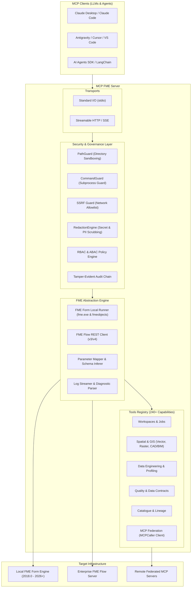

<div align="center">
  
  <h1>MCP FME</h1>
  <p><strong>Universal, secure, production-grade Model Context Protocol (MCP) server for Safe Software FME (2018.0 – 2026+), FME Form, FME Flow, and spatial data engineering.</strong></p>

  <p>
    <a href="https://pypi.org/project/fme-mcp-ultra/"></a>
    <a href="https://pypi.org/project/fme-mcp-ultra/"></a>
    <a href="https://github.com/mwjouini/fme-mcp-ultra/actions/workflows/ci.yml"></a>
    <a href="https://github.com/mwjouini/fme-mcp-ultra/actions/workflows/security.yml"></a>
    <a href="https://opensource.org/licenses/Apache-2.0"></a>
    <a href="https://www.python.org/"></a>
    <a href="https://modelcontextprotocol.io/"></a>
    <a href="https://glama.ai/mcp/servers/mwjouini/fme-mcp-ultra"></a>
    <a href="https://www.safe.com/"></a>
  </p>
</div>

Usable by any standard MCP client: **Claude Desktop, Claude Code, Cursor, VS Code, Antigravity, Windsurf, LangChain, and OpenAI Agents SDK.**

---

## 🌟 Overview

Safe Software introduced native Model Context Protocol (MCP) support in FME 2026 (`safe.mcp` / `MCPCaller` in 2026.1 and native Flow MCP Server in 2026.2). However, many teams run on **FME 2018.0 through 2025**, which previously lacked any way to connect LLMs and AI agents with their spatial data pipelines.

**MCP FME** (`fme-mcp-ultra`) bridges this gap:
1. **Works with All FME Releases (2018.0 to 2026+)**: Works locally with FME Form (`fme.exe` and `fmeobjects` bindings) and remotely with FME Flow REST APIs (v3 & v4).
2. **Dynamic Workspace Tools**: Discovers `.fmw` workspaces, extracts published parameters, and exposes them as typed MCP tools for your AI assistant.
3. **Desktop Interactivity**: Live environment diagnostics, XML canvas topology inspection, detached GUI launching (`FME Workbench`, `FME Data Inspector`), and dataset feature previews.
4. **Security by Default**: Directory sandboxing (`PathGuard`), shell command guards (`CommandGuard`), network filtering (`SSRF Guard`), and automatic PII/credential redaction.
5. **Outbound MCP Federation**: Acts as both an MCP server and client, allowing multi-server tool chaining.
6. **Geospatial Utilities**: Built-in coordinate reprojection, buffering, geometry validation, dataset profiling, and data contracts.

---

## 🏛️ System Architecture



---

## ⚡ 1-Command Universal Installation (Recommended)

Get up and running immediately with **MCP FME** — **ZERO dependencies** (no Python, no `uv`, and no `uvx` needed)!

The universal installer automatically discovers your local **FME Form** installation, hooks into its native engine runtime or fetches the pre-built standalone binary, and **automatically configures Claude Desktop, Cursor, Antigravity, VS Code, and Windsurf**:

### Windows (PowerShell)
```powershell
irm https://raw.githubusercontent.com/mwjouini/fme-mcp-ultra/main/scripts/install.ps1 | iex
```

### Linux / macOS (Bash)
```bash
curl -fsSL https://raw.githubusercontent.com/mwjouini/fme-mcp-ultra/main/scripts/install.sh | bash
```

> **✨ Key Highlights of the 1-Command Installer:**
> - **Zero External Dependencies**: Operates out-of-the-box on standard systems without requiring Python, uv, or build tools.
> - **Native FME Form Engine Detection**: Seamlessly detects FME Form (2018.0 through 2026+) via Windows Registry, environment variables (`FME_HOME`, `FME_DIR`), standard directories (`C:\Program Files\FME`, `/opt/fme`), and system `PATH`.
> - **Auto-Configures AI Clients**: Instantly detects and writes ready-to-run MCP configurations for **Claude Desktop**, **Cursor**, **Antigravity**, **VS Code**, and **Windsurf**.
> - **Instant Health Verification**: Automatically runs `fme-mcp-ultra doctor` to verify licenses, engine bindings, and spatial tools.

---

## 📦 Alternative Installation Options

### Option A: Standalone Executable (GitHub Releases)
Download pre-compiled self-contained single-file binaries (`fme-mcp-ultra.exe` for Windows, `fme-mcp-ultra` for Linux) directly from [GitHub Releases](https://github.com/mwjouini/fme-mcp-ultra/releases/latest) with no installation or Python required.

### Option B: Run with `uvx` (For Python / uv Developers)
```bash
uvx fme-mcp-ultra serve --transport stdio
```

### Option C: Standard `pip` Installation
```bash
pip install fme-mcp-ultra
fme-mcp-ultra doctor
fme-mcp-ultra serve --transport stdio
```

---

## 🔌 MCP Client Configurations

> [!TIP]
> **Automatic Setup Available**: If you ran the [1-Command Universal Installation](#-1-command-universal-installation-recommended), your MCP clients (**Claude Desktop**, **Cursor**, **Antigravity**, **VS Code**, **Windsurf**) have already been auto-detected and configured! The manual configurations below are provided for custom setups or reference.

### 1. Claude Desktop
Add this to `%APPDATA%\Claude\claude_desktop_config.json` (Windows) or `~/Library/Application Support/Claude/claude_desktop_config.json` (macOS):

**Option A — With `uvx` (If uv is installed):**
```json
{
  "mcpServers": {
    "mcp-fme": {
      "command": "uvx",
      "args": ["fme-mcp-ultra", "serve", "--transport", "stdio"]
    }
  }
}
```

**Option B — With Python (`py` on Windows after `py -m pip install fme-mcp-ultra`):**
```json
{
  "mcpServers": {
    "mcp-fme": {
      "command": "py",
      "args": ["-m", "fme_mcp_ultra.cli.main", "serve", "--transport", "stdio"]
    }
  }
}
```

**Option C — Standalone FME Form Engine (Uses FME's embedded Python runtime):**
```json
{
  "mcpServers": {
    "mcp-fme": {
      "command": "C:\\Program Files\\FME\\fme.exe",
      "args": ["python", "-m", "fme_mcp_ultra.cli.main", "serve", "--transport", "stdio"]
    }
  }
}
```

### 2. Antigravity / Cursor / VS Code
Add to your client's MCP configuration settings:

```json
{
  "mcpServers": {
    "mcp-fme": {
      "command": "fme-mcp-ultra",
      "args": ["serve", "--transport", "stdio"]
    }
  }
}
```

### 3. Streamable HTTP / Docker Deployment
```bash
docker run -d --name fme-mcp-ultra \
  -p 8000:8000 \
  -e FME_FLOW_URL="https://fme-flow.your-org.com" \
  -e FME_FLOW_TOKEN="your-fme-flow-api-token" \
  ghcr.io/mwjouini/fme-mcp-ultra:latest
```

### 4. FME Workbench Desktop Live Hook
To allow FME Workbench to report live translation events (status, duration, features read/written) directly to your AI agent:
1. Open FME Workbench: **Navigator** -> **Workspace Parameters** -> **Scripting**.
2. Paste [`examples/fme-workbench/startup_script.py`](examples/fme-workbench/startup_script.py) into **Startup Python Script**.
3. Paste [`examples/fme-workbench/shutdown_script.py`](examples/fme-workbench/shutdown_script.py) into **Shutdown Python Script**.
4. Read the full [FME Desktop Integration Guide](docs/desktop-integration.md).

---

## 🧰 Highlighted Tools Catalogue

| Domain | Key Tools | Description |
| :--- | :--- | :--- |
| **Desktop Interactivity** | `fme_diagnose`, `fme_inspect_canvas`, `fme_open_in_workbench`, `fme_open_in_inspector`, `fme_preview_dataset` | Live environment diagnosis, XML canvas graph parsing, detached GUI launching, and instant dataset feature preview. |
| **Workspaces** | `fme_discover_workspaces`, `fme_get_workspace`, `fme_run_workspace`, `fme_compare_workspaces`, `fme_audit_performance`, `fme_export_markdown_docs` | Crawls directories, extracts published parameters, audits performance bottlenecks, exports markdown documentation, and executes `.fmw` workspaces. |
| **Spatial Analysis** | `gis_reproject`, `gis_buffer`, `gis_validate_geometry`, `gis_intersection`, `gis_difference`, `gis_simplify`, `gis_bounding_box` | High-precision CRS conversion (EPSG:4326 to 2154 / 3857), spatial boolean operations (intersection/difference), polygon simplification, bounding box extraction, circular buffering, and polygon validation. |
| **Data Engineering** | `data_read_metadata`, `data_profile` | Column analysis, null counts, distinct value distribution, and format inspection. |
| **Data Quality** | `quality_score_dataset`, `quality_generate_data_contract` | Computes completeness scores and generates standard Data Contract YAML. |
| **Catalogue** | `catalog_register_asset`, `catalog_search_assets`, `catalog_get_lineage` | Registers datasets, performs semantic search, and maps upstream/downstream dependencies. |
| **Orchestration** | `workflow_create`, `workflow_get`, `workflow_run` | Constructs multi-step execution DAGs combining FME, validation checks, and scripts. |
| **MCP Federation** | `mcp_register_server`, `mcp_list_servers` | Connects external MCP servers to chain tools and fan-out requests. |
| **Governance** | `gov_get_tenant_config`, `gov_redact_pii`, `gov_classify_dataset` | Enforces GDPR/UK-GDPR data classification and automated PII scrubbing. |
| **Diagnostics** | `fme_info`, `fme_list_transformers`, `fme_list_packages`, `fme_execute_python` | Queries build/licensing, searches 500+ transformers, and runs in-engine Python. |

---

## 🛡️ Enterprise Security Model

**MCP FME** is engineered with a strict **Default-Deny** security posture:

- **PathGuard**: Enforces canonical path resolution (`os.path.realpath`) and verifies containment within `FME_ALLOWED_DIRS`. Traversal escapes (`..`) and null bytes are rejected.
- **CommandGuard**: Zero shell invocations (`shell=False`). Executable names and arguments are validated against an authorised binary whitelist, blocking metacharacter injection (`|`, `;`, `&`, `$`).
- **SSRF Guard**: Pre-resolves outbound DNS hostnames and prevents calls to loopback (`127.0.0.1`), private networks (`10.0.0.0/8`, `192.168.0.0/16`), and cloud metadata APIs (`169.254.169.254`).
- **RedactionEngine**: Real-time scrubbing of Bearer tokens, API credentials, email addresses, and payment card numbers before output delivery.
- **Role-Based Access Control (RBAC)**: Enforces role permissions (`platform_admin`, `workspace_operator`, `spatial_analyst`, `auditor`, `read_only`).

---

## 📊 FME Version Compatibility

**MCP FME** is compatible with all versions of Safe Software FME from **2018.0 through 2026+**:

| FME Version | Compatibility | FME Form (Desktop) | FME Flow (Server) | How it works |
| :--- | :---: | :---: | :---: | :--- |
| **FME 2026+** | **Full** | ✅ Yes | ✅ Yes | Works alongside native FME 2026 MCP endpoints, adding `stdio` desktop transport and security controls. |
| **FME 2025.x** | **Full** | ✅ Yes | ✅ Yes | Direct `fme.exe` execution, in-memory `fmeobjects` bindings, canvas XML topology parsing, FME Flow REST v3. |
| **FME 2021 – 2024** | **Full** | ✅ Yes | ✅ Yes | Identical `.fmw` XML canvas schema, CLI commands, and FME Flow REST v3 API. |
| **FME 2018 – 2020** | **Full** | ✅ Yes | ✅ Yes | Full support for FME Server REST API v3 (introduced in 2018.0) and local workspace execution. |
| **FME 2015 – 2017** | **Partial** | ⚠️ CLI Only | ❌ Legacy REST v2 | Command-line `fme.exe` workspace runner supported; REST API v2 deprecated. |

---

## 💻 CLI Usage

```bash
# Verify environment and FME installation
fme-mcp-ultra doctor

# Inspect a workspace file
fme-mcp-ultra inspect path/to/workspace.fmw

# Launch stdio server for desktop clients
fme-mcp-ultra serve --transport stdio

# Launch Streamable HTTP server
fme-mcp-ultra serve --transport streamable-http --host 0.0.0.0 --port 8000
```

---

## 🤝 Contributing

Contributions are welcomed under our [Contributing Guide](CONTRIBUTING.md) and [Code of Conduct](CODE_OF_CONDUCT.md).

---

## 📄 Licence

Licensed under the **Apache License 2.0**. See [LICENSE](LICENSE) for details.
Copyright © 2026 Mohamed Wael JOUINI and Contributors.

